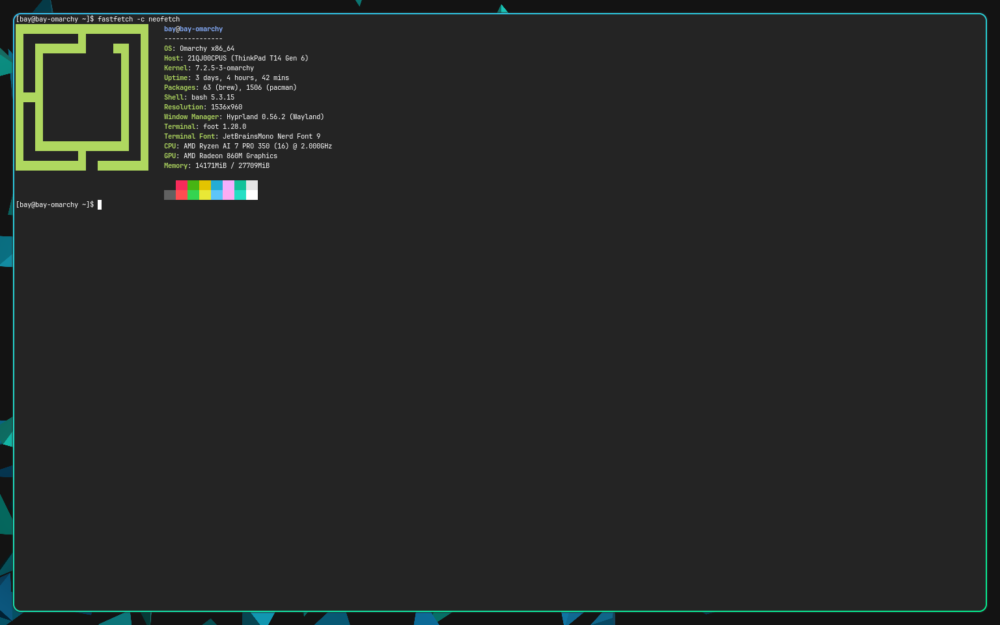
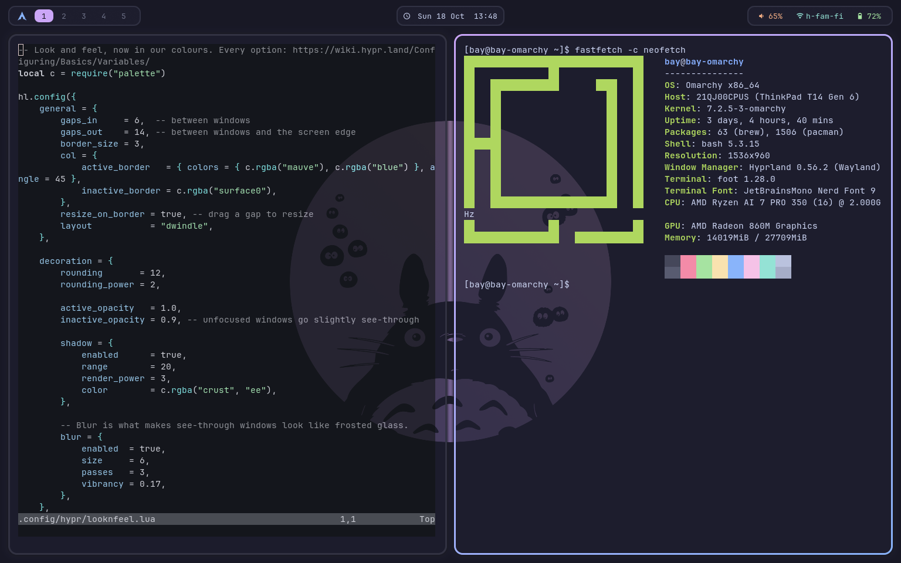

# Linux Ricing 101

Take a stock Hyprland install to a fully themed desktop, one small step at a time. These
are the dotfiles and the walkthrough from the Lug Nuts workshop at UTA.

| Before | After |
|---|---|
|  |  |

## What's in here

| | |
|---|---|
| [`GUIDE.md`](GUIDE.md) | The step-by-step walkthrough. Start here. |
| [`stages/`](stages/) | A complete, working config for every step. Each folder mirrors `~/.config/`. |
| [`assets/`](assets/) | The wallpaper and the screenshots above. |

## The steps

Each step is its own folder, so you can start anywhere and compare any two.

| Step | Folder | What it adds |
|---|---|---|
| 0 | [`00-stock`](stages/00-stock) | Hyprland exactly as it installs. It works, but it's nobody's desktop yet |
| 1 | [`01-basics`](stages/01-basics) | The config split into small files, and keybinds that make sense |
| 2 | [`02-wallpaper`](stages/02-wallpaper) | A wallpaper with hyprpaper, started at login |
| 3 | [`03-colors`](stages/03-colors) | One colour palette, gaps, gradient borders, blur and animations |
| 4 | [`04-terminal`](stages/04-terminal) | foot, the terminal, in the same colours |
| 5 | [`05-bar`](stages/05-bar) | A status bar with waybar |
| 6 | [`06-launcher`](stages/06-launcher) | An app launcher with fuzzel |
| 7 | [`07-notifications`](stages/07-notifications) | Notifications with mako |
| 8 | [`08-polish`](stages/08-polish) | Window rules, screenshots and smart gaps |

## Try it

You'll need Arch Linux (other distros work with small changes) and Hyprland 0.55 or newer,
which uses a Lua config. [`GUIDE.md`](GUIDE.md) lists every package to install.

```sh
git clone https://github.com/lugnuts-at-UTA/linux-ricing-101.git
cd linux-ricing-101
```

Then follow the guide from step 0, or jump straight to the finished rice. Back up first:
the stages overwrite these folders in `~/.config`.

```sh
for d in hypr foot waybar fuzzel mako; do
  [ -d ~/.config/$d ] && cp -r ~/.config/$d ~/.config/$d.bak
done
cp -r stages/08-polish/. ~/.config/
mkdir -p ~/Pictures/wallpapers && cp assets/wallpaper.png ~/Pictures/wallpapers/
```

Log out and back in so the bar, wallpaper and notifications start.

## Keys

From step 1 on, `SUPER` is the "Windows" key.

| Keys | Action |
|---|---|
| `SUPER + Return` | Terminal |
| `SUPER + Space` | App launcher (step 6+) |
| `SUPER + Q` | Close the window |
| `SUPER + arrows` or `h j k l` | Move focus |
| `SUPER + 1…9` | Switch workspace |
| `SUPER + SHIFT + E` | Quit Hyprland |

The guide has the full list.

## Credits

- Colours: [Catppuccin](https://catppuccin.com/) Mocha.
- Wallpaper: the Totoro background from Omarchy's Catppuccin theme.
- Everything Hyprland: the [Hyprland wiki](https://wiki.hypr.land/).

Built and tested with Hyprland 0.56.2, waybar 0.15.0, hyprpaper 0.8.4, foot 1.28.0,
fuzzel 1.15.0 and mako 1.11.0.
